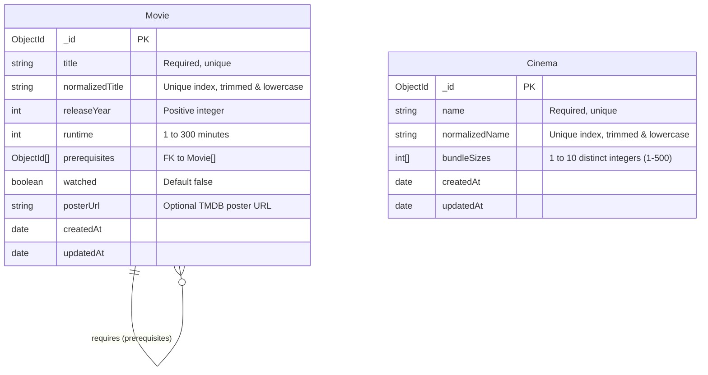

# Doomsday Ready — MCU Prep Tool

A full-stack web application designed for Marvel Cinematic Universe (MCU) fans preparing for *Avengers: Doomsday*. It allows users to track MCU movies, compute topological rewatch plans based on prerequisite dependency chains, and calculate the exact minimum-bundle cinema seat allocation for opening-night group bookings using dynamic programming.

---

## Table of Contents

1. [Key Features](#key-features)
2. [Technology Stack](#technology-stack)
3. [Architecture & Repository Structure](#architecture--repository-structure)
4. [Data Model](#data-model)
5. [Core Algorithms](#core-algorithms)
6. [Prerequisites](#prerequisites)
7. [Environment Configuration](#environment-configuration)
8. [Getting Started](#getting-started)
9. [Available Scripts](#available-scripts)
10. [Testing & Quality Checks](#testing--quality-checks)
11. [API Reference](#api-reference)
12. [AI Usage Disclosure](#ai-usage-disclosure)

---

## Key Features

### 1. Movies & Prerequisite Management
- **Movie Management (Create, List, Update)**: Create, list, and update movies with title, release year, runtime, watched status, and prerequisite dependencies (movie deletion is intentionally omitted per the project specification).
- **Data Integrity & Validation**:
  - Normalized case-insensitive and trimmed uniqueness on movie titles.
  - Positive integer release years and valid runtime (1–300 minutes).
  - Referenced prerequisites must exist and cannot self-reference or duplicate.
- **Cycle Prevention**: Validates the proposed graph before persisting any changes. Direct, indirect, or disconnected cyclic dependencies are rejected with HTTP `409 Conflict` and error code `CIRCULAR_DEPENDENCY`.
- **Quick Watched Toggle**: Toggle watched status directly from movie cards or the rewatch plan view.

### 2. Interactive Rewatch Plan
- **Target Selection**: Select any movie to view its complete prerequisite sequence.
- **Topological Watch Order**: Backend-calculated prerequisite-first order ensuring every prerequisite is watched before the movies that require it.
- **Shared Dependency Deduplication**: Diamond dependencies (e.g. *Iron Man* required by both *The Avengers* and *Civil War*) appear exactly once. Target movie is excluded from its own plan.
- **Progress Tracking**: Real-time watched counts (e.g., "4 of 7 watched"), visual progress bar, and calculation of total remaining runtime for unwatched movies.

### 3. Cinema Booking & Bundle Optimization
- **Cinema Management**: Add cinemas with custom seat bundle sizes (1–10 distinct integers from 1 to 500).
- **Exact Minimum-Bundle Optimization**: Computes the optimal combination of seat bundles that sums to exactly the requested group size (1 to 10,000) using bottom-up dynamic programming (unbounded knapsack).
- **Deterministic Tie-Breaking**: When multiple combinations produce the same minimum bundle count, larger bundles are prioritized.
- **Impossible Combinations**: Clearly identifies when no exact combination can sum to the group size (`possible: false`).
- **Client-Side Booking Plan Persistence**: Persist calculated quotes directly to browser `localStorage` using a versioned key (`doomsday-ready-bookings-v1`). Because the application does not have user accounts, client-side persistence provides profile isolation across different browsers and profiles. Booking snapshots preserve cinema name, bundle sizes, group size, bundle breakdown, and totals at the time of calculation.

---

## Technology Stack

| Layer | Technologies |
|---|---|
| **Monorepo** | npm Workspaces (`apps/api`, `apps/web`) |
| **Frontend** | React 18, Vite 6, TypeScript 5.7, Tailwind CSS v4, React Router 7 |
| **Backend** | Node.js, Express 4.21, TypeScript 5.7, Mongoose 8.9, Zod 4 |
| **Database** | MongoDB Atlas (or local MongoDB instance) |
| **Testing** | Vitest 5.1, Supertest 7.3, mongodb-memory-server 11.3 |
| **Code Quality** | ESLint 9 (Flat Config), Prettier 3.4, TypeScript Strict Mode |

---

## Architecture & Repository Structure

```text
doomsday-ready/
├── apps/
│   ├── api/                           # Backend Express REST API
│   │   ├── src/
│   │   │   ├── config/                # Environment and database connection
│   │   │   ├── middleware/            # Error handling, validation, not-found
│   │   │   ├── modules/
│   │   │   │   ├── movies/            # Movie model, service, controller, graph algorithms, tests
│   │   │   │   └── cinemas/           # Cinema model, service, controller, DP algorithm, tests
│   │   │   ├── routes/                # Health check and top-level routes
│   │   │   ├── scripts/               # Optional database seed script
│   │   │   ├── utils/                 # ObjectId helpers
│   │   │   ├── app.ts                 # Express application setup
│   │   │   └── server.ts              # Server bootstrap and database connection
│   │   ├── package.json
│   │   ├── tsconfig.json
│   │   └── vitest.config.ts
│   │
│   └── web/                           # Frontend React SPA
│       ├── src/
│       │   ├── api/                   # Typed API client functions
│       │   ├── components/            # Reusable UI, layout, modals, and feature components
│       │   │   ├── booking/           # Cinema modal, quote card, saved booking card
│       │   │   ├── movies/            # Movie card, movie form modal, stats overview
│       │   │   ├── rewatch/           # Rewatch movie item list with watched toggle
│       │   │   └── ui/                # Button, modal, alert, badge primitives
│       │   ├── lib/                   # LocalStorage persistence helpers and tests
│       │   ├── pages/                 # LandingPage, MoviesPage, RewatchPlanPage, BookingPage
│       │   ├── types/                 # Frontend TypeScript API contracts
│       │   ├── App.tsx                # App routing configuration
│       │   └── main.tsx               # Entry point
│       ├── package.json
│       ├── vite.config.ts
│       └── tsconfig.json
│
├── docs/                              # Project specifications, rules, and roadmap
├── .env.example                       # Root environment variable template
├── package.json                       # Monorepo root configuration & scripts
└── README.md
```

---

## Data Model



> [!NOTE]
> **Saved Booking Plans Persistence**:
> To support independent user profiles without requiring an authentication system, saved booking plans are persisted entirely in the browser's `localStorage` under the versioned key `doomsday-ready-bookings-v1`. Each saved record stores a complete, immutable snapshot of the cinema configuration, group size, bundle breakdown, total bundles, and total seats.

---

## Core Algorithms

All graph traversals and optimization logic are **handwritten from scratch** with **zero external graph or knapsack libraries**.

### 1. Cycle Detection (Handwritten DFS)
- **Module**: `apps/api/src/modules/movies/movie.graph.ts`
- **Method**: Depth-First Search with recursion stack tracking (3-color state: unvisited, visiting, visited).
- **Behavior**:
  - Prevents self-dependencies, direct cycles ($A \rightarrow B \rightarrow A$), and indirect cycles ($A \rightarrow B \rightarrow C \rightarrow A$).
  - Supports disconnected graphs and multi-branch dependency graphs.
  - When a cycle is detected, returns `hasCycle: true` alongside the exact human-readable cycle path (e.g. `["Avengers: Doomsday", "Avengers: Endgame", "Avengers: Doomsday"]`).
- **Complexity**: Time $\mathcal{O}(V + E)$, Space $\mathcal{O}(V)$.

### 2. Rewatch Order (Topological Sort via Handwritten DFS)
- **Module**: `apps/api/src/modules/movies/movie.graph.ts`
- **Method**: Post-order Depth-First Search traversal with a global visited set.
- **Behavior**:
  - Traverses from the target movie to all transitive prerequisites.
  - Appends each prerequisite to the order only after all of its own prerequisites have been visited.
  - Deduplicates shared dependencies in diamond structures.
  - Excludes the target movie itself from the rewatch sequence.
  - Calculates total unwatched runtime and watched counts.
- **Complexity**: Time $\mathcal{O}(V + E)$ for reachable subgraph, Space $\mathcal{O}(V)$.

### 3. Minimum-Bundle Seat Allocation (Bottom-Up Dynamic Programming)
- **Module**: `apps/api/src/modules/cinemas/cinema.booking.ts`
- **Method**: Bottom-up Dynamic Programming (Unbounded Knapsack / Minimum Coin Change variant).
- **Behavior**:
  - Evaluates `minBundles[0...G]` and `choice[0...G]` for requested group size $G$ and bundle sizes $B$.
  - Evaluates bundle sizes in descending order: when two choices yield an equal bundle count, the larger bundle size is preferred for deterministic tie-breaking.
  - If `minBundles[G]` remains unreachable ($\infty$), returns `{ possible: false }`.
  - Reconstructs exact breakdown of bundle sizes and quantities by tracing back `choice[G]`.
- **Complexity**: Time $\mathcal{O}(G \times |B|)$, Space $\mathcal{O}(G)$. Highly efficient even for the maximum group size of 10,000.

---

## Prerequisites

- **Node.js**: v20.x or higher
- **npm**: v10.x or higher
- **MongoDB**: MongoDB Atlas cluster or a local MongoDB instance (`mongodb://localhost:27017/doomsday_ready`)

---

## Environment Configuration

Copy the example environment files to configure the backend and frontend:

```bash
# Backend configuration
cp apps/api/.env.example apps/api/.env

# Frontend configuration
cp apps/web/.env.example apps/web/.env
```

### Backend (`apps/api/.env`)

| Variable | Description | Default / Example |
|---|---|---|
| `NODE_ENV` | Application environment (`development`, `production`, `test`) | `development` |
| `PORT` | HTTP server listening port | `5000` |
| `MONGODB_URI` | MongoDB Atlas or local connection string | `mongodb+srv://<user>:<pwd>@<cluster>.mongodb.net/doomsday-ready` |
| `CLIENT_URL` | Frontend URL for CORS configuration | `http://localhost:5173` |

> [!IMPORTANT]
> **MongoDB Atlas Network Access (IP Whitelisting)**:
> MongoDB Atlas requires connecting client IP addresses to be listed in the cluster's **Network Access** IP Access List. If running in an environment with a dynamic or new IP, add your IP (or `0.0.0.0/0` for development evaluation) in the Atlas console under **Network Access > Add IP Address**.
> 
> *Graceful degradation*: If the MongoDB connection is blocked or unavailable, the backend will still start and provide health checks (`database: "disconnected"`), and automated tests run against an isolated in-memory MongoDB server.

### Frontend (`apps/web/.env`)

| Variable | Description | Default / Example |
|---|---|---|
| `VITE_API_URL` | Backend API base URL for client requests | `http://localhost:5000/api` |

---

## Getting Started

### 1. Install Dependencies
```bash
npm install
```

### 2. Seed Sample Data (Optional)
An optional, idempotent database seed script is provided to populate the 8 assessment MCU movies with prerequisite relationships and 3 sample cinemas:
```bash
npm run seed
```
*(Or `npm run seed -w apps/api`)*

### 3. Run the Development Servers
Start both the backend API and frontend Vite server concurrently:
```bash
npm run dev
```
- **Frontend**: [http://localhost:5173](http://localhost:5173)
- **Backend API**: [http://localhost:5000/api](http://localhost:5000/api)
- **Health Check**: [http://localhost:5000/api/health](http://localhost:5000/api/health)

You can also run each workspace individually:
```bash
npm run dev:api  # Runs API server on port 5000 with tsx watch
npm run dev:web  # Runs Vite dev server on port 5173
```

---

## Available Scripts

| Command | Purpose |
|---|---|
| `npm run dev` | Concurrently starts both API and Web dev servers |
| `npm run dev:api` | Starts the Express API server with automatic reload |
| `npm run dev:web` | Starts the Vite frontend server with HMR |
| `npm run seed` | Seeds the database with the 8 MCU movies and sample cinemas |
| `npm run build` | Builds both backend (TypeScript compilation) and frontend (Vite production bundle) |
| `npm run test` | Runs the Vitest test suite with supertest and mongodb-memory-server |
| `npm run typecheck` | Validates TypeScript types across both `apps/api` and `apps/web` |
| `npm run lint` | Runs ESLint across all TypeScript and React files |
| `npm run lint:fix` | Runs ESLint with automated fix flag |
| `npm run format:check` | Verifies code formatting with Prettier |
| `npm run format` | Formats all code files with Prettier |

---

## Testing & Quality Checks

The project includes unit and integration tests covering data models, validations, handwritten algorithms, and API HTTP behaviors.

Run the test suite:
```bash
npm run test
```

Run full quality and compilation checks:
```bash
npm run typecheck
npm run lint
npm run format:check
npm run build
```

---

## API Reference

All endpoints are prefixed with `/api` and return standardized JSON response envelopes.

### Response Envelopes

**Success Envelope (`200 OK`, `201 Created`):**
```json
{
  "success": true,
  "data": {}
}
```

**Error Envelope (`400`, `404`, `409`, `500`):**
```json
{
  "success": false,
  "error": {
    "code": "ERROR_CODE",
    "message": "Human-readable explanation of error."
  }
}
```

### Endpoints Overview

| Method | Endpoint | Purpose | Request Body / Params | Status Codes |
|---|---|---|---|---|
| `GET` | `/health` | Server and database status | None | `200` |
| `GET` | `/movies` | List all movies | None | `200` |
| `POST` | `/movies` | Create a new movie | `{ title, releaseYear, runtime, prerequisites?, watched?, posterUrl? }` | `201`, `400`, `409` |
| `PATCH` | `/movies/:id` | Update movie details or prerequisites | `{ title?, releaseYear?, runtime?, prerequisites?, watched?, posterUrl? }` | `200`, `400`, `404`, `409` |
| `GET` | `/movies/:id/rewatch-order` | Get ordered prerequisite list & stats | Param: `:id` (target movie) | `200`, `400`, `404` |
| `GET` | `/cinemas` | List all cinemas | None | `200` |
| `POST` | `/cinemas` | Create a new cinema | `{ name, bundleSizes }` | `201`, `400`, `409` |
| `GET` | `/cinemas/:id/booking?groupSize=X` | Calculate minimum bundle quote | Query: `groupSize` (1–10,000) | `200`, `400`, `404` |

---

## TMDB Attribution & Metadata

Movie metadata and poster image assets populated by the seed script are sourced from **The Movie Database (TMDB)**.

> [!NOTE]
> **This product uses the TMDB API but is not endorsed or certified by TMDB.**
> To learn more or explore movie details, visit [themoviedb.org](https://www.themoviedb.org/). The application includes official TMDB logo attribution in the site footer following TMDB's branding guidelines.

*Note on Avengers: Doomsday (TMDB ID: 1003596)*: As an upcoming 2026 theatrical release, its official final theatrical cut runtime is not yet published or confirmed on TMDB. The 180-minute value in the seed data is a provisional placeholder for assessment preparation planning, satisfying the application's runtime validation constraint (1–300 minutes). All prerequisite relationships remain strictly preserved.

---

## AI Usage Disclosure

In compliance with the assessment guidelines:
- **AI Tooling**: Google Antigravity (powered by Gemini models) was utilized as an assistive agent during project development.
- **Assisted Areas**:
  - Scaffolding project configuration and npm workspaces.
  - Assisting with boilerplate Express controllers, route definitions, and Zod schemas.
  - Assisting with generating Tailwind CSS component layouts and modal dialogs.
  - Writing automated test suites (Vitest, Supertest).
- **Core Algorithms & Implementation**:
  - The cycle detection algorithm (DFS with recursion stack state), rewatch order traversal (DFS topological sort), and cinema seat bundle optimization (bottom-up dynamic programming) were implemented directly according to the project specifications without external libraries.
  - The project owner has reviewed all code, understands the architecture and algorithmic complexity, and is able to explain all implementation choices and design trade-offs.
