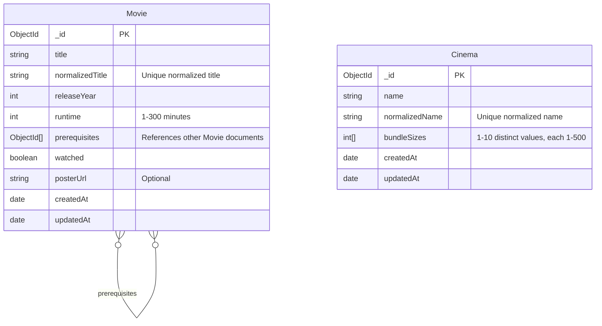

# Doomsday Ready

A small MCU watch-planning app I built around one question: *what should I rewatch before Avengers: Doomsday?*

You can manage movies and their prerequisites, get a watch order for any target movie, and work out the smallest combination of cinema seat bundles for a group booking.

**[Open the app](https://doomsday-ready-eta.vercel.app)** · [Backend API](https://doomsday-ready-2tic.onrender.com/api) · [API health](https://doomsday-ready-2tic.onrender.com/api/health)

> **A note about loading:** The backend runs on Render's free plan and may go to sleep after a period of inactivity. If that happens, please allow around 50 seconds for the first request while the server wakes up. Later requests should be faster.

[](https://github.com/mostafarakib/doomsday-ready) [](https://github.com/mostafarakib/doomsday-ready)

## What it does

- **Movie list:** Add and update movies, set their runtime and watched status, and connect movies through prerequisites.
- **Rewatch plan:** Choose a target movie and get its prerequisites in watch order. Shared dependencies appear once, and the plan shows watched progress and remaining runtime.
- **Cinema booking:** Add cinemas and their available seat-bundle sizes. Enter a group size to find an exact allocation using the fewest bundles.
- **Saved plans:** Save booking quotes in the browser and return to them later.

## A few decisions worth explaining

**Why are booking plans stored in the browser?**

My first idea was to save bookings in a separate MongoDB collection. While testing that flow, I noticed a problem: there is no login or user system in this project, so a booking saved by one visitor would be visible to everyone using the same backend. That wasn't the behaviour I wanted. I moved saved booking plans to `localStorage` instead. Each browser keeps its own saved quotes, while movies and cinemas remain in MongoDB Atlas.

These are saved quote snapshots, not actual cinema reservations. The app does not contact cinemas or reserve seats.

## How I approached the algorithms

I didn't start with DFS and dynamic programming straight away. I first thought about simpler brute-force approaches, then discussed the problem and the trade-offs with AI. That discussion helped me choose algorithms that handle shared dependencies and larger group sizes more efficiently. I then implemented the algorithms in the project without external graph or optimization libraries.

**Movie prerequisites**

My initial idea was to recursively follow each movie's prerequisites until I had collected everything needed. That is a straightforward way to explore the dependency chain, but shared prerequisites can be visited more than once. It also needs a reliable way to detect cycles; otherwise, a circular dependency could make the traversal continue indefinitely.

After discussing these issues with AI, I used DFS with visit-state tracking instead. A three-colour DFS detects cycles, while a post-order traversal produces the prerequisite-first watch order. A visited set ensures that a shared prerequisite is included only once.

- Cycle detection: `O(V + E)` time and `O(V)` space.
- Rewatch ordering: `O(V + E)` time and `O(V)` space for the reachable prerequisite graph.

**Cinema seat bundles**

My first thought was to try different combinations of bundle sizes until I found one that matched the group size, then compare the combinations to find the one using the fewest bundles. That can work for small examples, but the number of combinations grows quickly as the group size and available bundle types increase.

After discussing alternatives with AI, I chose bottom-up dynamic programming (the minimum-coin-change approach). It builds the best result for smaller group sizes and uses those results to calculate larger ones. This avoids repeatedly exploring the same combinations. If multiple allocations use the same number of bundles, the implementation prefers larger bundles to keep the result deterministic.

- Time: `O(G × B)`.
- Space: `O(G)`.
- `G` is the requested group size; `B` is the number of available bundle types.

## How it works

| Part | Technology |
|---|---|
| Frontend | React, Vite, TypeScript, Tailwind CSS, React Router |
| Backend | Node.js, Express, TypeScript, Zod |
| Database | MongoDB Atlas with Mongoose |
| Browser storage | `localStorage` for saved booking-plan snapshots |
| Tests | Vitest, Supertest, `mongodb-memory-server` |
| Development environment | npm workspaces, Docker Compose |

## Repository structure

The project is an npm-workspaces monorepo. The API and frontend are kept in separate workspaces:

```text
doomsday-ready/
├── apps/
│   ├── api/
│   │   ├── src/
│   │   │   ├── config/             # Environment and database configuration
│   │   │   ├── middleware/         # Error handling, validation and 404 handling
│   │   │   ├── modules/
│   │   │   │   ├── movies/         # Movie model, service, controller, graph logic and tests
│   │   │   │   └── cinemas/        # Cinema model, service, controller, DP logic and tests
│   │   │   ├── routes/             # Health check and API routes
│   │   │   ├── scripts/            # Database seed script
│   │   │   ├── utils/              # Shared helpers
│   │   │   ├── app.ts              # Express app configuration
│   │   │   └── server.ts           # HTTP server entry point
│   │   ├── Dockerfile.dev
│   │   ├── package.json
│   │   └── vitest.config.ts
│   └── web/
│       ├── src/
│       │   ├── api/                # Typed API client and health API
│       │   ├── components/         # Movie, rewatch, booking and shared UI
│       │   ├── hooks/              # React hooks, including backend health monitoring
│       │   ├── lib/                # Local storage and health-monitor utilities
│       │   ├── pages/              # Application pages
│       │   ├── types/              # Frontend TypeScript types
│       │   ├── App.tsx             # Routes and global app components
│       │   └── main.tsx            # Frontend entry point
│       ├── Dockerfile.dev
│       ├── package.json
│       └── vite.config.ts
├── docs/
├── .dockerignore
├── docker-compose.yml
├── package.json
├── package-lock.json
├── vercel.json
└── README.md
```

## Data model and persistence

Movies and cinemas are stored in MongoDB Atlas through Mongoose. A movie's `prerequisites` field contains references to other movie documents, so the movie model forms a self-referencing directed acyclic graph (DAG). A cinema stores its available bundle sizes as an array of integers.



Saved booking plans are different: they are not MongoDB documents. When I explicitly save a quote, the browser stores a snapshot in `localStorage` under `doomsday-ready-bookings-v1`. It includes the cinema details used for the quote, group size, bundle breakdown, totals and save time. Editing a cinema later does not change an already saved snapshot.

## Run it locally

You need Node.js, npm, and a MongoDB connection string (MongoDB Atlas is fine).

```bash
git clone https://github.com/mostafarakib/doomsday-ready.git
cd doomsday-ready
npm ci
cp apps/api/.env.example apps/api/.env
cp apps/web/.env.example apps/web/.env
```

Add your MongoDB connection string to `apps/api/.env`:

```env
MONGODB_URI=your_mongodb_connection_string
```

Then seed the sample data and start both apps:

```bash
npm run seed
npm run dev
```

The frontend runs at `http://localhost:5173` and the API at `http://localhost:5000`.

### Using Docker Compose

Create `apps/api/.env` as shown above, then run:

```bash
docker compose up --build
```

Open `http://localhost:5173`. Vite forwards API requests to the API container. MongoDB runs outside Compose; the API connects to the instance configured in `MONGODB_URI`.

## API overview

All routes are prefixed with `/api`.

| Method | Route | Purpose |
|---|---|---|
| `GET` | `/health` | Check API and database health |
| `GET` | `/movies` | List movies |
| `POST` | `/movies` | Create a movie |
| `PATCH` | `/movies/:id` | Update a movie |
| `GET` | `/movies/:id/rewatch-order` | Calculate a movie's rewatch plan |
| `GET` | `/cinemas` | List cinemas |
| `POST` | `/cinemas` | Create a cinema |
| `GET` | `/cinemas/:id/booking?groupSize=X` | Calculate a seat-bundle quote |

The API returns a consistent JSON envelope with `success` and either `data` or an `error` object.

## Tests and checks

The current suite has **113 passing tests**: 83 API tests and 30 frontend tests.

```bash
npm run test
npm run typecheck
npm run lint
npm run build
```

## Deployment

- Frontend: [Vercel](https://doomsday-ready-eta.vercel.app)
- API: [Render](https://doomsday-ready-2tic.onrender.com/api)
- Database: MongoDB Atlas

The frontend calls the Render API directly in production. Vercel serves the React app and handles client-side route fallback.

## Movie data

Movie titles and poster images in the sample data are sourced from [The Movie Database (TMDB)](https://www.themoviedb.org/).

This product uses the TMDB API but is not endorsed or certified by TMDB.

The `Avengers: Doomsday` runtime in the seed data is a provisional 180-minute value because the final theatrical runtime was not confirmed when I prepared the sample data.

## AI assistance

I used Google Antigravity during development for help with project scaffolding, boilerplate, UI implementation, test drafting, and discussing implementation approaches. For the graph and seat-allocation problems, I discussed simpler brute-force ideas and their limitations with AI before choosing DFS and dynamic programming. I reviewed and tested the resulting code, and implemented those algorithms without external graph or optimization libraries.
