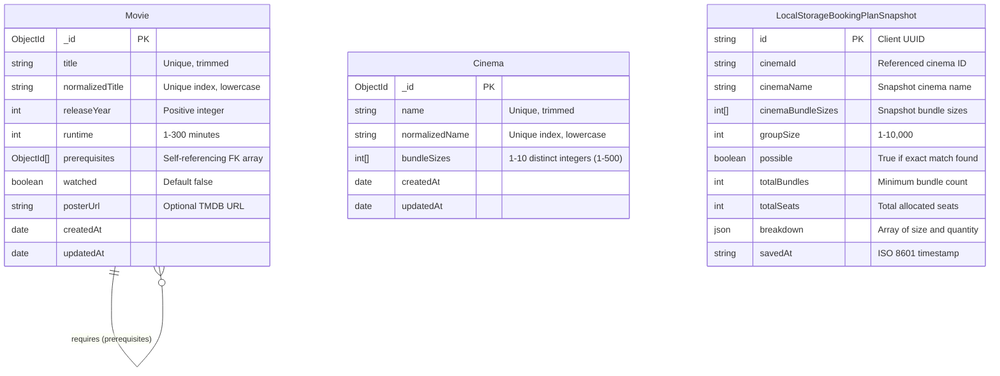

# Doomsday Ready — MCU Prep Tool

A full-stack web application designed for Marvel Cinematic Universe (MCU) fans preparing for *Avengers: Doomsday*. It allows users to track MCU movies, compute topological rewatch plans based on prerequisite dependency chains, and calculate the exact minimum-bundle cinema seat allocation for opening-night group bookings using dynamic programming.

[](https://doomsday-ready-eta.vercel.app)
[](https://doomsday-ready-2tic.onrender.com/api)
[](https://doomsday-ready-2tic.onrender.com/api/health)
[](https://github.com/)
[](https://github.com/)

---

## Live Deployments

- **Frontend (Web Application)**: [https://doomsday-ready-eta.vercel.app](https://doomsday-ready-eta.vercel.app)
- **Backend API**: [https://doomsday-ready-2tic.onrender.com/api](https://doomsday-ready-2tic.onrender.com/api)
- **API Health Check**: [https://doomsday-ready-2tic.onrender.com/api/health](https://doomsday-ready-2tic.onrender.com/api/health)

---

## Table of Contents

1. [Key Features](#key-features)
2. [Technology Stack](#technology-stack)
3. [Architecture & Repository Structure](#architecture--repository-structure)
4. [Data Model & Persistence](#data-model--persistence)
5. [Core Algorithms](#core-algorithms)
6. [Quick Start with Docker Compose](#quick-start-with-docker-compose)
7. [Local Development (Without Docker)](#local-development-without-docker)
8. [Environment Variables Reference](#environment-variables-reference)
9. [Available Scripts](#available-scripts)
10. [Testing & Quality Verification](#testing--quality-verification)
11. [API Reference](#api-reference)
12. [Deployment Architecture](#deployment-architecture)
13. [TMDB Attribution & Metadata](#tmdb-attribution--metadata)
14. [AI Usage Disclosure](#ai-usage-disclosure)

---

## Key Features

### 1. Movie & Prerequisite Graph Management
- **Movie Catalog (Create, List, Update)**: Manage MCU movies with title, release year, runtime, watched status, and prerequisite dependencies. (Movie deletion is intentionally omitted per the project specification to preserve dependency graph integrity.)
- **Data Integrity & Validation**:
  - Normalized case-insensitive and trimmed uniqueness validation on movie titles.
  - Positive integer release years and runtime boundaries (1–300 minutes).
  - Prerequisites must refer to existing movies, cannot self-reference, and duplicate IDs are automatically deduplicated.
- **Cycle Prevention**: Validates the complete dependency graph before persisting changes. Direct cycles ($A \rightarrow B \rightarrow A$), indirect cycles ($A \rightarrow B \rightarrow C \rightarrow A$), and multi-branch cyclic loops are rejected with HTTP `409 Conflict` (`CIRCULAR_DEPENDENCY`).
- **Quick Watched Toggle**: Toggle movie watched status directly from movie cards or inside the rewatch plan view.

### 2. Interactive Rewatch Plan
- **Target Selection**: Select any movie to view its complete transitive prerequisite chain.
- **Topological Watch Order**: Prerequisite-first order ensuring every foundational movie is watched before titles that require it.
- **Diamond Dependency Deduplication**: Shared dependencies (e.g. *Iron Man* required by both *The Avengers* and *Captain America: Civil War*) appear exactly once at their correct foundational position. The target movie is excluded from its own prerequisite list.
- **Progress Tracking**: Real-time watched counters (e.g., "4 of 7 watched"), visual progress percentage bar, and calculation of total remaining runtime in minutes for unwatched movies.

### 3. Cinema Booking & Seat Bundle Optimization
- **Cinema Management**: Register cinemas with customizable seat bundle package sizes (1–10 distinct integers from 1 to 500).
- **Exact Minimum-Bundle Optimization**: Computes the optimal combination of seat bundles that sums to exactly the requested group size (1 to 10,000) using bottom-up dynamic programming (unbounded knapsack / coin-change variant).
- **Deterministic Tie-Breaking**: When multiple bundle combinations yield the same minimal bundle count, larger bundles are prioritized.
- **Impossibility Detection**: Accurately flags when no exact combination can sum to the group size (`possible: false`).
- **Client-Side Booking Plan Persistence**: Persist calculated quotes directly to browser `localStorage` under the versioned key `doomsday-ready-bookings-v1`. Because the application does not implement user authentication, client-side persistence provides profile isolation across different browsers and profiles. Saved records store complete, immutable snapshots of the cinema name, bundle sizes, group size, bundle breakdown, total bundles, and total seats at the time of calculation.

---

## Technology Stack

| Layer | Technologies |
|---|---|
| **Monorepo** | npm Workspaces (`apps/api`, `apps/web`) |
| **Frontend** | React 18, Vite 6, TypeScript 5.7, Tailwind CSS v4, React Router 7, Lucide React |
| **Backend** | Node.js (20+), Express 4.21, TypeScript 5.7, Mongoose 8.9, Zod 4, CORS, Dotenv |
| **Database & Storage** | MongoDB Atlas (Movies & Cinemas), Browser `localStorage` (Booking Plan Snapshots) |
| **Containerization** | Docker, Docker Compose, `node:24-alpine` |
| **Testing** | Vitest 5.1 (113 tests), Supertest 7.3, `mongodb-memory-server` 11.3 |
| **Code Quality** | ESLint 9 (Flat Config), Prettier 3.4, TypeScript Strict Mode |
| **Deployment** | Vercel (Frontend SPA), Render (Backend API), MongoDB Atlas (Cloud Database) |

---

## Architecture & Repository Structure

The project is structured as a lightweight npm workspace monorepo separating the Express API and React SPA while sharing root-level tooling and configuration:

```text
doomsday-ready/
├── apps/
│   ├── api/                           # Backend Express REST API
│   │   ├── src/
│   │   │   ├── config/                # Environment configuration and database connection
│   │   │   ├── middleware/            # Error handling, Zod validation, 404 handler
│   │   │   ├── modules/
│   │   │   │   ├── movies/            # Movie model, service, controller, graph algorithms, tests
│   │   │   │   └── cinemas/           # Cinema model, service, controller, DP algorithm, tests
│   │   │   ├── routes/                # Health check and mounted router definitions
│   │   │   ├── scripts/               # Idempotent database seed script (8 MCU movies, 3 cinemas)
│   │   │   ├── utils/                 # MongoDB ObjectId validation helpers
│   │   │   ├── app.ts                 # Express application and middleware configuration
│   │   │   └── server.ts              # HTTP server entry point
│   │   ├── Dockerfile.dev             # Alpine development container for API
│   │   ├── package.json
│   │   ├── tsconfig.json
│   │   └── vitest.config.ts
│   │
│   └── web/                           # Frontend React SPA
│       ├── src/
│       │   ├── api/                   # Typed API client and URL builder
│       │   ├── components/            # UI components (booking, movies, rewatch, primitives)
│       │   ├── lib/                   # LocalStorage persistence helpers and tests
│       │   ├── pages/                 # LandingPage, MoviesPage, RewatchPlanPage, BookingPage
│       │   ├── types/                 # Shared frontend TypeScript interfaces
│       │   ├── App.tsx                # React Router 7 configuration
│       │   └── main.tsx               # Application entry point
│       ├── Dockerfile.dev             # Alpine development container for Vite
│       ├── package.json
│       ├── vite.config.ts             # Vite configuration with proxy for dev
│       └── tsconfig.json
│
├── docs/                              # Project specifications and guidelines
├── .dockerignore                      # Docker context exclusion rules
├── .env.example                       # Root environment variable template
├── docker-compose.yml                 # Local development orchestration
├── package.json                       # Monorepo workspaces and scripts
├── package-lock.json                  # Root lockfile preserving dependency tree
├── vercel.json                        # Vercel SPA client-side routing fallback
└── README.md
```

---

## Data Model & Persistence

The application employs a deliberate hybrid persistence model:
1. **MongoDB Atlas (Server-Side Persistence)**: Stores shared, core domain entities (`Movie` and `Cinema`) via Mongoose. The `Movie` model forms a self-referencing Directed Acyclic Graph (DAG) through the `prerequisites` array.
2. **Browser `localStorage` (Client-Side Snapshot Persistence)**: Stores user-specific booking plan quotes under key `doomsday-ready-bookings-v1`. This ensures individual user profiles remain isolated across browsers without requiring user accounts or authentication.



> [!NOTE]
> **Saved Booking Snapshots**:
> When a user calculates a quote and explicitly saves it, a complete, immutable snapshot of the cinema configuration, bundle breakdown, and totals is written to `localStorage`. Subsequent edits to cinema bundle sizes do not mutate historical saved booking records.

---

## Core Algorithms

All graph traversals and optimization routines are **handwritten from scratch** with **zero external graph or knapsack libraries**.

### 1. Cycle Detection (Handwritten 3-Color DFS)
- **File**: `apps/api/src/modules/movies/movie.graph.ts`
- **Method**: Depth-First Search with explicit recursion stack tracking using 3-color states (`0: UNVISITED`, `1: VISITING`, `2: VISITED`).
- **Behavior**:
  - Detects direct cycles ($A \rightarrow B \rightarrow A$), indirect cycles ($A \rightarrow B \rightarrow C \rightarrow A$), and self-references ($A \rightarrow A$).
  - Correctly evaluates multi-branch and disconnected graphs by iterating through all vertices.
  - When a cycle is detected, returns `hasCycle: true` alongside the exact human-readable cycle path (e.g. `["Avengers: Doomsday", "Avengers: Endgame", "Avengers: Doomsday"]`).
- **Complexity**:
  - **Time Complexity**: $\mathcal{O}(V + E)$ where $V$ is the number of movies and $E$ is the total prerequisite edges.
  - **Space Complexity**: $\mathcal{O}(V)$ for recursion call stack and color tracking maps.

### 2. Rewatch Order (Topological Sort via Handwritten DFS)
- **File**: `apps/api/src/modules/movies/movie.graph.ts`
- **Method**: Post-order Depth-First Search traversal with a global visited set.
- **Behavior**:
  - Traverses the transitive prerequisite subgraph starting from the requested target movie.
  - Appends each prerequisite to the sequence only after all of its own prerequisites have been visited, guaranteeing prerequisite-first order.
  - Deduplicates shared dependencies in diamond structures (e.g. *Iron Man* visited only once even if required by multiple movies).
  - Excludes the target movie itself from the rewatch plan.
  - Computes cumulative statistics: watched count, unwatched count, and remaining unwatched runtime.
- **Complexity**:
  - **Time Complexity**: $\mathcal{O}(V' + E')$ on the reachable subgraph of prerequisites.
  - **Space Complexity**: $\mathcal{O}(V')$ for the visited set and post-order traversal stack.

### 3. Minimum-Bundle Seat Allocation (Bottom-Up Dynamic Programming)
- **File**: `apps/api/src/modules/cinemas/cinema.booking.ts`
- **Method**: Bottom-up Dynamic Programming (Unbounded Knapsack / Minimum Coin Change variant).
- **Behavior**:
  - Solves for minimum bundles required for every capacity from $1$ to requested group size $G$:
    $$\text{dp}[i] = \min_{b \in B, b \le i} (\text{dp}[i - b] + 1)$$
  - Evaluates bundle sizes in descending order: when two choices yield an equal minimum bundle count, the larger bundle size is preferred for deterministic tie-breaking.
  - If $\text{dp}[G]$ remains unreachable ($\infty$), the algorithm returns `{ possible: false }`.
  - Reconstructs the exact breakdown of bundle sizes and quantities by backtracking through parent choice array `choice[G]`.
- **Complexity**:
  - **Time Complexity**: $\mathcal{O}(G \times |B|)$ where $G$ is the group size (up to 10,000) and $|B|$ is the number of bundle sizes (up to 10). Executes in sub-millisecond time.
  - **Space Complexity**: $\mathcal{O}(G)$ for the `dp` and `choice` arrays.

---

## Quick Start with Docker Compose

A lightweight multi-container development environment is configured using Docker Compose and Node 24 Alpine images.

### Prerequisites
- Docker Engine v24+ and Docker Compose v2+
- A MongoDB Atlas cluster connection string (or reachable MongoDB instance)

### 1. Set Up Environment Variables
Copy the API environment template and provide your MongoDB Atlas connection string:
```bash
cp apps/api/.env.example apps/api/.env
```
Edit `apps/api/.env` and update `MONGODB_URI`:
```env
MONGODB_URI=mongodb+srv://<username>:<password>@<cluster>.mongodb.net/doomsday-ready
```

> [!IMPORTANT]
> **Atlas IP Whitelisting**: Ensure your current IP address (or `0.0.0.0/0` for development evaluation) is whitelisted in your MongoDB Atlas **Network Access** settings.

### 2. Start the Application
Run the containers from the repository root:
```bash
docker compose up --build
```

- **Frontend (Web)**: [http://localhost:5173](http://localhost:5173)
- **Backend API**: [http://localhost:5000/api](http://localhost:5000/api)
- **API Health Check**: [http://localhost:5000/api/health](http://localhost:5000/api/health)

### 3. Architecture & Operational Notes
- **Vite Proxy Networking**: In the Docker environment, frontend requests to `/api/*` are automatically forwarded through Vite's internal development proxy to `http://api:5000` via the internal Docker bridge network (`doomsday-network`).
- **Resource Limits & Memory Footprint**: Both `api` and `web` containers are configured with memory limits of 768 MB each. During development evaluation, observed combined idle memory usage was approximately **~382 MiB** (~203 MiB for API, ~179 MiB for Web), leaving substantial headroom on 8 GB RAM developer machines. *(Note: Actual memory usage may vary based on OS, host Docker runtime, and caching.)*
- **Live Code Reload**: Source directories (`apps/api/src` and `apps/web/src`) are mounted as host volumes for hot module replacement (HMR) and automatic server restarts (`tsx watch`).
- **Shutting Down**:
  ```bash
  docker compose down
  ```

---

## Local Development (Without Docker)

### Prerequisites
- **Node.js**: v20.x or v24.x
- **npm**: v10.x or higher
- **MongoDB**: MongoDB Atlas connection string or local MongoDB instance

### 1. Install Dependencies
Install dependencies across all workspaces using clean install:
```bash
npm ci
```

### 2. Configure Environment Files
```bash
# Configure API
cp apps/api/.env.example apps/api/.env

# Configure Web
cp apps/web/.env.example apps/web/.env
```

Ensure `MONGODB_URI` in `apps/api/.env` points to your Atlas cluster or local database.

### 3. Seed Sample Data (Optional)
Run the idempotent seed script to populate 8 core MCU movies with prerequisite dependencies and 3 cinemas:
```bash
npm run seed
```

### 4. Run Development Servers
Start both the backend API and frontend Vite server concurrently:
```bash
npm run dev
```

You can also run individual services separately:
```bash
npm run dev:api  # Runs API on port 5000 with tsx watch
npm run dev:web  # Runs Vite dev server on port 5173
```

---

## Environment Variables Reference

### Backend (`apps/api/.env`)

| Variable | Description | Default / Example |
|---|---|---|
| `PORT` | HTTP server port | `5000` |
| `NODE_ENV` | Application environment (`development`, `production`, `test`) | `development` |
| `MONGODB_URI` | MongoDB Atlas or local connection string | `mongodb+srv://<user>:<pwd>@<cluster>.mongodb.net/doomsday-ready` |
| `CLIENT_URL` | Frontend origin for CORS policy | `http://localhost:5173` |

### Frontend (`apps/web/.env`)

| Variable | Description | Default / Example |
|---|---|---|
| `VITE_API_URL` | Base URL for API requests. Leave blank in local development to use the Vite proxy (`/api`). Set to the Render backend URL in production. | `https://doomsday-ready-2tic.onrender.com/api` |
| `VITE_PROXY_TARGET` | Target backend for Vite dev proxy. Used in Docker Compose (`http://api:5000`). | `http://localhost:5000` |

---

## Available Scripts

All scripts can be executed from the repository root:

| Command | Purpose |
|---|---|
| `npm run dev` | Concurrently starts both API and Web dev servers |
| `npm run dev:api` | Starts the Express API with `tsx watch` |
| `npm run dev:web` | Starts the Vite React frontend with HMR |
| `npm run seed` | Seeds the database with 8 MCU movies and sample cinemas |
| `npm run build` | Compiles API TypeScript and builds Vite production bundle |
| `npm run test` | Runs the full Vitest suite (113 tests across backend & frontend) |
| `npm run typecheck` | Validates TypeScript types across both workspaces |
| `npm run lint` | Runs ESLint across all TypeScript and React files |
| `npm run lint:fix` | Runs ESLint with automated fixes |
| `npm run format:check` | Verifies code formatting with Prettier |
| `npm run format` | Formats all code files with Prettier |

---

## Testing & Quality Verification

The test suite contains **113 automated tests** with 100% pass rate:
- **83 Backend Tests (`apps/api`)**: Unit and integration tests covering Mongoose models, cycle detection DFS, rewatch order DFS, bottom-up DP seat optimization, REST routes, input validation, and error envelopes. Tested with Supertest and `mongodb-memory-server`.
- **30 Frontend Tests (`apps/web`)**: Unit and component tests covering browser `localStorage` persistence, snapshot integrity, API client URL resolution with trailing slash normalization, and global backend health monitoring with automatic recovery and outage detection.

Execute test suite:
```bash
npm run test
```

Execute full verification pipeline:
```bash
npm run typecheck
npm run lint
npm run format:check
npm run build
```

---

## API Reference

All backend routes are prefixed with `/api` and return standardized JSON response envelopes.

### Response Envelopes

**Success Envelope (`200 OK`, `201 Created`):**
```json
{
  "success": true,
  "data": {}
}
```

**Error Envelope (`400 Bad Request`, `404 Not Found`, `409 Conflict`, `500 Internal Error`):**
```json
{
  "success": false,
  "error": {
    "code": "ERROR_CODE",
    "message": "Human-readable explanation of error."
  }
}
```

### Endpoints Overview

| Method | Endpoint | Description | Request Body / Parameters | Status Codes |
|---|---|---|---|---|
| `GET` | `/health` | Server and database health check | None | `200` |
| `GET` | `/movies` | List all movies | None | `200` |
| `POST` | `/movies` | Create a movie | `{ title, releaseYear, runtime, prerequisites?, watched?, posterUrl? }` | `201`, `400`, `409` |
| `PATCH` | `/movies/:id` | Update movie details or prerequisites | `{ title?, releaseYear?, runtime?, prerequisites?, watched?, posterUrl? }` | `200`, `400`, `404`, `409` |
| `GET` | `/movies/:id/rewatch-order` | Calculate ordered prerequisites and stats | Param: `:id` (target movie) | `200`, `400`, `404` |
| `GET` | `/cinemas` | List all cinemas | None | `200` |
| `POST` | `/cinemas` | Create a cinema | `{ name, bundleSizes }` | `201`, `400`, `409` |
| `GET` | `/cinemas/:id/booking?groupSize=X` | Calculate minimum bundle seat quote | Query: `groupSize` (1–10,000) | `200`, `400`, `404` |

### Sample Responses

#### 1. Rewatch Order (`GET /api/movies/:id/rewatch-order`)
```json
{
  "success": true,
  "data": {
    "targetMovie": {
      "id": "674011111111111111111108",
      "title": "Avengers: Doomsday"
    },
    "rewatchOrder": [
      {
        "id": "674011111111111111111101",
        "title": "Iron Man",
        "releaseYear": 2008,
        "runtime": 126,
        "watched": true,
        "posterUrl": "https://image.tmdb.org/t/p/w500/78lPtwv72eTNqFW9COBYI0dWDJa.jpg"
      },
      {
        "id": "674011111111111111111102",
        "title": "The Avengers",
        "releaseYear": 2012,
        "runtime": 143,
        "watched": true,
        "posterUrl": "https://image.tmdb.org/t/p/w500/RYMX2wcKCBAr24UyPD7xwmjaTn.jpg"
      }
    ],
    "totalCount": 7,
    "watchedCount": 4,
    "unwatchedCount": 3,
    "totalRuntimeMinutes": 1058,
    "unwatchedRuntimeMinutes": 482
  }
}
```

#### 2. Booking Quote (`GET /api/cinemas/:id/booking?groupSize=14`)
```json
{
  "success": true,
  "data": {
    "cinema": {
      "id": "674022222222222222222201",
      "name": "Stark Tower IMAX",
      "bundleSizes": [2, 3, 5]
    },
    "groupSize": 14,
    "possible": true,
    "totalBundles": 4,
    "totalSeats": 14,
    "breakdown": [
      { "size": 5, "quantity": 2 },
      { "size": 2, "quantity": 2 }
    ]
  }
}
```

---

## Deployment Architecture

The application is deployed across cloud platforms:

```text
┌─────────────────────────┐         ┌─────────────────────────┐
│     Vercel (Frontend)   │  HTTPS  │    Render (Backend API) │
│  React 18 SPA (Vite 6)  │────────>│   Express 4.21 / Node   │
│ Client-side routing SPA │         │  CORS, Zod, Validation  │
└─────────────────────────┘         └────────────┬────────────┘
             │                                   │
             │ LocalStorage                      │ Mongoose 8.9
             ▼                                   ▼
┌─────────────────────────┐         ┌─────────────────────────┐
│  Browser LocalStorage   │         │      MongoDB Atlas      │
│ doomsday-ready-bookings │         │  Movies & Cinemas Data  │
└─────────────────────────┘         └─────────────────────────┘
```

- **Frontend (Vercel)**: Configured with `vercel.json` rewrite rules routing all client paths to `/index.html` for React Router 7. Environment variable `VITE_API_URL` directs API requests directly to the Render backend.
- **Backend API (Render)**: Express API hosted as a Web Service. Configured with CORS restricting access to the Vercel frontend domain and connecting to MongoDB Atlas via `MONGODB_URI`.
- **Database (MongoDB Atlas)**: Managed MongoDB cloud database with SSL/TLS encryption and IP access list protection.

---

## TMDB Attribution & Metadata

Movie metadata and poster image assets populated by the seed script are sourced from **The Movie Database (TMDB)**.

> [!NOTE]
> **This product uses the TMDB API but is not endorsed or certified by TMDB.**
> To learn more or explore movie details, visit [themoviedb.org](https://www.themoviedb.org/). The application includes official TMDB logo attribution in the site footer following TMDB's branding guidelines.

*Note on Avengers: Doomsday (TMDB ID: 1003596)*: As an upcoming 2026 theatrical release, its official final theatrical cut runtime is not yet published or confirmed on TMDB. The 180-minute value in the seed data is a provisional placeholder for assessment preparation planning, satisfying the application's runtime validation constraint (1–300 minutes). All prerequisite relationships remain strictly preserved.

---

## AI Usage Disclosure

In compliance with the assessment guidelines:
- **AI Tooling**: Google Antigravity (powered by Gemini models) was utilized as an assistive agent during project development.
- **Assisted Areas**:
  - Scaffolding project configuration and npm workspaces.
  - Assisting with boilerplate Express controllers, route definitions, and Zod schemas.
  - Assisting with generating Tailwind CSS component layouts and modal dialogs.
  - Authoring automated test suites (Vitest, Supertest).
- **Core Algorithms & Implementation**:
  - The cycle detection algorithm (DFS with recursion stack state), rewatch order traversal (DFS topological sort), and cinema seat bundle optimization (bottom-up dynamic programming) were implemented directly according to the project specifications without external libraries.
  - The project owner has reviewed all code, understands the architecture and algorithmic complexity, and is able to explain all implementation choices and design trade-offs.
